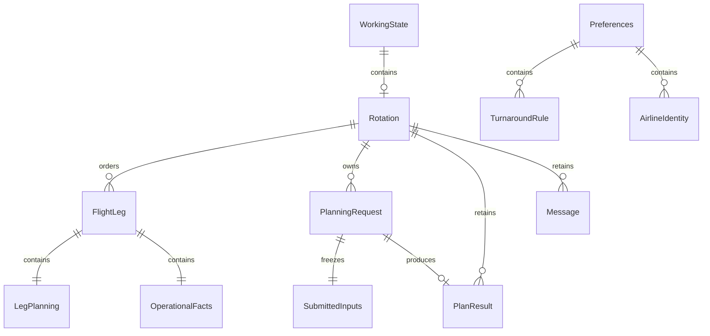

# AutoDispatch — proposed data model

**Review draft, amended 15 November 2026.** Field names and storage shapes remain proposals, not application code or an approved schema. The targeted review rules in DEC-051–054 are accepted; this does not approve the complete model or close PRE-09. Electron + React + TypeScript is decided; JSON is the preferred persistence direction.

Read alongside the [domain and persistence proposal](domain-persistence-proposal.md) and authoritative [PRD](prd.md). DEC-046/050 record the accepted stack and utility-process/domain/integration separation. This amendment aligns the model with accepted DEC-051–054 while preserving PRE-02/04/09 uncertainties. No service payload fields or endpoints are assumed to be verified.

## Model at a glance

Keep one **Rotation** containing ordered **FlightLegs**, with rotation-scoped **PlanningRequests**, **PlanResults** and **Messages**. Preferences and reusable turnaround rules have a separate lifetime. A leg contains three different kinds of information: editable planning, returned planning results, and observed operational facts.

These are plain data objects, not SQL tables or an inheritance hierarchy. All operational objects save together in `working-state.json`. Pure domain modules validate and change them; the utility-process persistence adapter serializes the snapshot. Storage metadata such as checksums belongs to the adapter, not the flight domain. The renderer receives display snapshots, not writable domain objects.

## Common value conventions

| Value | Proposed representation and meaning |
|---|---|
| IDs | Opaque unique strings, generated through a domain port. Stable across restart; never derived from array position, airport or callsign. |
| UTC instant | Full ISO UTC string, e.g. `2026-11-15T13:23:00Z`. Field names identify simulator versus system clock. |
| Flight date | `YYYY-MM-DD`; full event instants still include their own dates, including overnight arrivals. |
| Unknown | Explicit `null`, not zero, empty string or a made-up time. Empty collections use `[]`. |
| Duration | Numeric minutes with a named field; finite and nonnegative. No unspecified time unit. |
| Fuel/weight | `{ value, unit }`, with unit `kg` or `lb`; fuel inputs that permit duration use a tagged minutes alternative. Zero means a supplied zero; null means unspecified/unavailable. |
| Revision | Nonnegative integer; snapshot revision changes per successful save, planning revision per change to relevant effective inputs. Neither uses simulator time. |
| External reference | Opaque service-provided identifier, nullable. Not interchangeable with our local request or result ID. |

Validate airport/callsign/catalogue values against the relevant accepted rules and verified integration contract. Do not prematurely encode guessed service lengths, identifier formats or unsupported planning options. Raw service DTOs stay in adapters; normalized domain values retain provenance and units.

## Files and top-level ownership

| File | Contents | Lifecycle |
|---|---|---|
| `working-state.json` | Storage envelope plus one nullable rotation and everything needed to resume it | Replaced atomically as described in the persistence proposal |
| `preferences.json` | Independently versioned preferences, turnaround rules, airline identities and non-secret integration references | Survives rotation replacement and clear |
| Optional document files | Immutable OFP documents referenced from the snapshot, if needed | Rotation-scoped; never used to discover or restore a rotation |

The working-state envelope has `schemaVersion`, `revision`, `savedAtSystemUtc`, `rotation`, and adapter-owned integrity metadata. A cleared rotation is explicitly `rotation: null`. Do not retain a deleted-rotation catalogue. The checksum encoding and Windows commit mechanism remain storage design details; a checksum cannot establish whether an old valid snapshot is current.

**Rotation**

| Field | Meaning |
|---|---|
| `id` | Unique working-rotation identity; replacement gets a new ID |
| `started` | True only after the matching first operational OFP successfully completes startup under M16; never inferred from airborne telemetry |
| `aircraft` | Current shared aircraft configuration used for editable legs |
| `legs` | Ordered FlightLeg array; order is stored once, not also in a separate position field |
| `planningRequests`, `planResults`, `messages` | Rotation-scoped collections described below |
| `handover` | Null or `{ inboundLegId, nextLegId, completedAtSimulatorUtc }`; the ten-minute due time is derived |
| `recoveryHolds` | Typed holds with the originating leg and any affected next-leg ID |

Derive the active leg from `legs[].lifecycle`; enforce at most one Active leg instead of maintaining a second mutable active-leg pointer. An unstarted rotation has none; a handover interval can also have none. This deliberately simplifies the earlier architecture sketch's active-leg pointer. Startup-in-progress is derived from an unstarted rotation and its first leg's outstanding operational-OFP request, initiated only by Start Rotation.

## Flight leg and planning

**FlightLeg**

| Field | Meaning |
|---|---|
| `id` | Stable leg identity |
| `lifecycle` | `pending`, `active` or `completed` only |
| `planningRevision` | Revision of effective inputs used to associate results |
| `planning` | LegPlanning value object |
| `operations` | OperationalFacts value object |
| `currentOfpId` | Null or latest associated successful operational PlanResult; may be Out of date |
| `advanceResultId` | Null or successful preliminary result for this next leg; persists the automatic-preparation success marker |
| `automaticPreliminaryMessageId` | Null or the one automatic preliminary message; explicit updates do not replace this marker |
| `arrivalDispatch` | Null or `{ inboundLegId, requestId, shutdownObserved }`; request ID is nullable until generation is requested |

`arrivalDispatch` tracks one automatic operational-OFP workflow, with no primary/fallback plan or request categories. Low-speed arrival and shutdown are opportunities to evaluate that same workflow. A saved successful outcome prevents another automatic generation even if a subsequent edit makes the OFP Out of date; explicit regeneration is separate. Pending/uncertain work prevents an overlapping request. After definitive failure, shutdown may permit another attempt. If updated gate timing changes the submitted inputs, create a new ordinary operational-OFP request and update this reference, preserving immutable submitted inputs on the previous request. `shutdownObserved` remembers eligibility when shutdown occurs during a pending request; it is not live proof that the aircraft is still grounded or that holds are clear.

**Accepted recovery clarification (DEC-053):** a recovery action creates an ordinary leg with a new ID and fresh planning inputs. It has no `recoveryOf` relationship or special recovery subtype; subsequent planning, dispatch and monitoring are identical to any other leg. The original completed attempt remains intact. M16 now reflects this rule. Recovery holds still identify the arrival requiring a user choice until that workflow is resolved; transient workflow context is not a permanent lineage relationship.

**LegPlanning**

| Field | Meaning |
|---|---|
| `originIcao`, `destinationIcao` | Planned airports; actual arrival is stored elsewhere |
| `atcCallsign`, `iataFlightNumber` | Separate identifiers; IATA number nullable |
| `flightDate` | Planning flight date |
| `aircraft` | Copy of effective shared aircraft values for this leg |
| `scheduledOffBlock`, `scheduledOnBlock` | Independently nullable ScheduleBaseline objects |
| `turnaround` | Resolved minutes, source (`override`, `prefixRule`, `default`), and optional source-rule ID |
| `fuelOptions` | Nullable ATC, weather, MEL, extra, contingency and final-reserve inputs with explicit units |
| `weightUnitPreference` | Nullable dispatch preference; never overrides returned OFP units |
| `simBriefOptions` | Only explicitly modelled supported options after PRE-02 mapping; no unvalidated generic settings bag |

A ScheduleBaseline contains `atUtc` and `source` (`manual` or `firstFiled`), plus the originating result ID for `firstFiled`. Automatic initialization from the first Filed value is a result-processing change, not a new user-input revision that immediately makes that same OFP stale. Explicit schedule edits before departure do change the effective planning revision when relevant to dispatch. Subsequent returned Filed values never reset the retained baseline.

**AircraftConfiguration** contains a tagged selection: either catalogue/manual setup (type, optional subtype/variant references and display labels) or a saved-airframe reference. It also contains optional registration and maximum passenger capacity. Saved-airframe use is optional; do not require unavailable personal-airframe listing. Keep returned/resolved aircraft details in the plan result as evidence of what SimBrief actually used. The exact override semantics of a saved airframe require PRE-02.

**Shared edit rule:** the shared aircraft object supplies defaults for current editable legs. Applying an edit copies values and increments affected revisions in the same snapshot. Reject a shared change that would alter generation-locked inputs. Departed/completed legs retain their copies. Therefore changing registration for the remaining legs cannot retroactively change a completed leg or an already submitted request. No reusable fleet model is needed.

## Operational facts, timestamps and holds

**OperationalFacts**

| Field | Meaning |
|---|---|
| `departed` | Permanent planning-lock fact; true even if departure was inferred from a recovered airborne observation and off-block is unknown |
| `airborneEstablished` | Durable flight context; permits later valid after-flight completion without requiring every phase |
| `phase` | Nullable confirmed phase from M04/M16; initially unknown, never a substitute for lifecycle |
| `actualOffBlockUtc`, `actualTakeoffUtc`, `actualLandingUtc`, `actualOnBlockUtc` | Independently nullable simulator-observed event times |
| `filedOffBlock`, `filedOnBlock` | Independently nullable `{ atUtc, ofpId }` values from the current operational OFP mapping |
| `arrival` | Null before arrival; otherwise `{ episodeId, outcome, actualAirportIcao, identificationSource }` |
| `phaseContext` | Only bounded confirmed context required by the eventually selected detector, e.g. operating altitude; exact shape waits for PRE-04 |

`arrival.outcome` is `destination`, `return`, `diversion` or `unresolved`. `actualAirportIcao` is null when unresolved. `identificationSource` distinguishes validated automatic identification from exceptional user confirmation; numerical confidence scores are not invented. An arrival episode ID distinguishes confirmed arrival opportunities when implementing the agreed bounce/go-around rules. The detector's re-entry/reset rules remain PRE-04 work; raw brief ground contacts do not create completed arrivals.

The three time concepts remain separately persisted: Scheduled in planning, Filed with its OFP provenance, Actual in operations. The display combines them. Returning an OFP updates Filed but cannot reset Actual. A current plan arriving after departure is still associated; `departed` remains true. Request completion releases only the generation lock.

Hold variants:

- `arrivalAirportUnresolved`: originating inbound leg; awaiting exceptional airport confirmation.
- `arrivalRecoveryChoice`: originating return/diversion leg; onward automation suspended; prompt visibility follows completion.
- `manualRepositionAwaitingResume`: originating leg and target next leg; only explicit Resume releases it.

Represent holds explicitly rather than one `automationPaused` boolean. Clearing an airport hold must not accidentally clear a manual-reposition hold. Complete the inbound despite unresolved airport identity, but do not clear a final rotation or activate/dispatch onward until the applicable outcome is resolved. If confirmation establishes a normal final arrival after completion, normal clearing follows.

Handover anchors to inbound actual completion, not current time after restart. Due time is completion plus ten simulator minutes. Consuming handover and activating its target happen in one snapshot; early qualifying departure additionally locks that leg. Reordering/removing an eligible target must reconcile handover references and continuity in the same command. It never records departure movement during a manual-reposition hold.

**Ordering during planning (DEC-052):** evaluate every insertion, removal and reorder against outstanding planning requests before applying it. Reject the whole edit if it changes a locked request's startup-first-leg identity, next-eligible-leg identity, or inbound predecessor/context used for readiness or preliminary messaging. Apply this to `prepared`, `possiblySent` and `uncertain` requests; normal completion/failure releases this protection together with the temporary lock. Do not cancel or reinterpret a request implicitly through a list edit. Changes confined to unaffected later legs remain permitted, subject to continuity and ordinary planning locks. Subsequent-leg activation/departure while its request is pending is still allowed: this restriction governs user schedule edits, not the accepted handover workflow. Store the relevant startup/inbound/target identity in the request context and recheck it before dependent effects; matching only leg ID and planning revision is insufficient.

## Requests and returned plans

Keep requests separate from results. An acknowledgement is neither an OFP nor commencement. These are domain-side records, not claims about external API field names.

**PlanningRequest**

| Field | Meaning |
|---|---|
| `id`, `rotationId`, `legId` | Local association; results must match all applicable identities |
| `kind` | `advancePreparation` or `operationalOfp`: the requested planning outcome, not the reason it was triggered |
| `planningRevision`, `submittedInputs` | Frozen effective leg/aircraft values plus resolved request-time readiness, taxi/turnaround inputs and their provenance |
| `eligibilityContext` | Captured startup-first-leg or inbound/next-leg identities needed by DEC-052; local coordination metadata, not an additional plan-kind enum or assumed service field |
| `state` | `prepared`, `possiblySent`, `succeeded`, `definitiveFailure` or `uncertain` |
| `attemptCount` | Bounded retry accounting for this logical action; no unlimited attempt log |
| `createdAtSystemUtc`, `lastAttemptAtSystemUtc`, `finishedAtSystemUtc` | Service/diagnostic times, with nulls where not applicable |
| `serviceReference`, `resultId` | Nullable verified external reference and local result association |
| `failure` | Null or normalized safe error category/details; never credentials or a whole unredacted response |

The coordinator evaluates eligibility at the relevant trigger; it does not classify flight plans by trigger. Startup follows the unstarted-rotation rule. Arrival, shutdown, manual generation, regeneration and generation for a newly added recovery leg all request an operational OFP. A verified same-plan editing API may require an explicit target service-plan reference in submitted inputs; that is an adapter contract detail, not a reason to retain the larger trigger enum. Advance preparation remains distinct even if the eventual supported service workflow implements it using a saved plan.

At most one unresolved planning request may lock a leg's affected inputs. Each actual network invocation also receives a distinct local attempt token so a delayed earlier response cannot overwrite a later definitive result. Retain the outstanding attempt token in the record; retry is permitted only after the previous attempt is definitively unsuccessful. Timeout alone is not that proof. A repeated success is a no-op; contradictory adapter outcomes are an integration error, not permission to mutate the plan twice.

`prepared` means the possibly-sent marker has not committed and the adapter has not been called under the write-before-send protocol. On restart, possibly-sent becomes uncertain. Uncertain handling and the temporary lock's escape policy remain PRE-02/question 21, not a new accepted workflow. Local request/attempt IDs provide correlation only, not service-side idempotency.

**PlanResult**

| Field | Meaning |
|---|---|
| `id`, `requestId`, `legId`, `planningRevision` | Immutable local association |
| `kind` | `preliminary` or `operationalOfp`; a preliminary result never starts the rotation |
| `servicePlanReference`, `receivedAtSystemUtc` | Nullable service identifier plus receipt time |
| `aircraft`, `route`, `flightIdentifiers` | Relevant returned identities, normalized and checked against the request |
| `filedTimes`, `taxiInMinutes`, `cruiseAltitude` | Nullable verified planning data with explicit event basis and units |
| `plannedPassengers`, `fuelAndWeights` | Returned planning values and units, not aircraft loading or actual uplift |
| `validationIssues` | Capacity/association/field validity findings; never silently clamp SimBrief values |
| `documentReference` | Optional rotation-scoped document reference; no assumed permanent service URL |

Fuel fields must distinguish next-leg block fuel, inbound planned burn and estimated arrival fuel, with destination/alternate basis and source association. Exact mapping is deliberately left to PRE-02/question 22; missing values remain null, with explanatory availability metadata where needed. An association mismatch cannot become the leg's current OFP. Whether a returned capacity violation blocks further dispatch use is not settled by inventing a new validity enum; follow the eventual verified validation policy under M08.

Retain results needed by the current OFP, advance result, message provenance, schedule baseline and known-successful workflow markers. A complete history of every superseded OFP is not an MVP requirement. Safe pruning must keep required references and enough success evidence to suppress repeats. This model does not require an event log.

## Messages and Hoppie submissions

**Message** contains `id`, `kind` (`automaticPreliminary` or `requestedUpdate`), `aboutLegId`, a frozen upcoming-flight identity/route summary, `inboundLegId`, `recipientCallsign`, frozen `senderCallsign` using the preferred `AD<current inbound ATC callsign>` format subject to DEC-055 validation, immutable `body`, source result IDs, `createdAtSimulatorUtc` where valid, `createdAtSystemUtc`, local `read`, and `submission`.

`submission` contains `state` (`notSubmitted`, `possiblySent`, `accepted`, `definitiveFailure`, `uncertain`), a local attempt token/count, optional safe service reference/error, and system-time attempt/acceptance timestamps. Not configured or transmission disabled leaves it not submitted; the current reason is derived from settings. It is not a mandatory delivery backlog. Whether enabling Hoppie later offers submission of existing messages is separate UI/policy work, not automatic behaviour introduced here.

Create the message and its automatic-message marker together before submitting. Acceptance ends retries. Local read/unread never means cockpit read, delivery or acknowledgement. Freeze both sender and inbound recipient callsigns even if the next leg subsequently activates. Under DEC-055, an explicit callsign-conflict rejection permits bounded delayed retries of this same message; ambiguous outcomes must not cause blind retries. Retry timing, limits and expiry/cancellation remain PRE-06 design work; exhaustion preserves the local log without blocking the rotation. Revised planning does not rewrite a previously generated message or cause another automatic one.

**Removal and retained history (DEC-051):** when an unflown leg is explicitly removed, retain generated message content for the rotation lifetime. Its frozen identity/route summary explains the message without retaining a hidden operational leg. Apply all cleanup in the same snapshot as the removal:

- Reject removal while a planning request for that leg is unresolved, or when the edit would invalidate another locked request under DEC-052.
- Retain the immutable PlanResults and terminal PlanningRequests required by retained messages or other surviving success/baseline references. Keep their result-to-request associations resolvable. Their leg IDs and captured eligibility context may refer to the removed leg strictly as historical provenance. Prune unreferenced terminal records and optional document references together; external document cleanup follows snapshot publication.
- Allow historical leg identifiers in messages, retained terminal requests and retained results to be absent from `legs`. This exception does not apply to unresolved requests, current-leg OFP/advance-result pointers, handover targets, arrival-dispatch links or recovery-hold targets.
- Reconcile live handover/target references and airport continuity before committing. Removing a target must not silently release an existing manual-reposition or arrival-recovery hold; retain the originating hold and require the applicable explicit recovery choice/Resume for its valid replacement target. Reject the edit if no valid reconciliation is available.
- Retained records cannot make a removed leg eligible, produce another automatic message, submit another network request or recreate it from a late callback. Historical success evidence is not a queue.

## Preferences and reusable rules

The preferences payload contains:

- Dispatch defaults: automation controls, proximity threshold (accepted default 20 minutes), default turnaround, taxi-in fallback and optional weight-unit preference. Other numerical defaults are not invented here. The exact mapping of the PRD's general and arrival automation controls should avoid redundant flags.
- Presentation/notifications: local-time display preference and message/OFP/failure notification choices. Persisting the board preference does not move its control into Settings.
- `turnaroundRules`: `{ id, callsignPrefixes, turnaroundMinutes, airlineId }`, with nullable airline membership.
- `airlines`: `{ id, name, icaoCode, iataCode }`, optional identity grouping; rule values are owned once by turnaroundRules rather than duplicated in airlines.
- Non-secret integration account identifiers/references and Hoppie-enabled preference. No authentication tokens or logon keys.

One rule can match EZY and EJU without an airline record. A per-leg override wins over a matched rule, which wins over the default. Longest matching prefix with rejection of equally specific conflicting rules remains a proposal. Applying changed profiles to existing editable legs is explicit; completed history never resolves values again from these mutable rules. Credentials follow the authoritative DEC-050 main-process storage boundary; domain objects contain no platform secret-store handles.

## Derived/transient state and validation

Do **not** persist additional authoritative copies of: editability, active-leg ID, next eligible leg, Out of date flag, UI dispatch label, unread count, timing status/colour, readiness estimate or handover due time. Derive them from the fields above. Out of date compares the associated result's input revision with the leg's effective planning revision. Domain rules still distinguish known result success from present freshness.

Keep live telemetry, freshness/session sequences, connection/authentication health, short confirmation windows, network timeout handles and UI selection transient. Persist only confirmed detector context necessary to resume; a saved phase/engine reading cannot prove current readiness. No telemetry samples are required to rebuild the rotation.

Validate these invariants on commands and snapshot load:

1. At most one working rotation and one Active leg; no Active leg in an unstarted rotation.
2. Current operational references resolve within the same rotation; IDs are unique. Only historical leg identifiers in retained messages, terminal requests and results may refer to a removed leg under DEC-051. Required message/result/request references still resolve, and those records cannot drive operational actions.
3. Departed/completed planning is locked; request completion cannot unlock it. Recovered airborne context establishes departure even with missing Actual times.
4. Completed means valid after-flight grounded/stationary/all-engines-stopped completion, not just phase PARKED. Missing touchdown remains allowed.
5. First successful matching operational OFP gates commencement; later handover has no new OFP prerequisite.
6. One automatic message per eligible subsequent leg; none for the initial leg. Known successful preparation/arrival generation/accepted submission is not automatically repeated.
7. Actual times are independent and non-editable. Do not reject recorded history merely because a manual simulator-clock change makes timestamps non-monotonic; planning-time conflicts are validated separately.
8. Clearing removes all rotation-owned state in one snapshot, preserving preferences/credentials. Stale callbacks cannot repopulate it.
9. User ordering edits cannot invalidate an unresolved request's captured eligibility context. Unrelated later-leg edits remain possible; normal handover/departure is not blocked by this ordering guard.

## Concrete review examples

| Situation | What changes / what stays |
|---|---|
| Completed A used registration G-AAAA; shared configuration changes to G-BBBB | Rotation default and eligible B/C planning copies change; A and old request snapshots retain G-AAAA. If B is generating, reject the shared edit. |
| Scheduled 13:00; returned Filed 13:20; observed Actual 13:23 | Store all three independently; derive +23-minute actual departure deviation. |
| B departs while its OFP is pending | B's departed fact locks planning; request retains submitted revision. Matching response updates OFP/Filed without clearing actuals or the lock. |
| A completes at 14:00Z; B departs at 14:06Z | Consume A→B handover and activate/lock B in one save. The derived 14:10 deadline later does nothing. |
| Hoppie accepted a message, then the app restarts | Accepted submission and automatic-message marker restore; no resend. A lost unsaved outcome instead restores uncertainty. |
| Final normal leg completes | Envelope retains its format/revision but rotation becomes null. Preferences and secret storage survive. |
| Remove a pending leg after its preliminary message/result exists | Remove the operational leg; retain the message and required result/terminal-request provenance. The snapshot reloads successfully, historical leg IDs do not recreate the leg, and no further dispatch occurs for it. |
| Insert/reorder a leg ahead of the target of an unresolved planning request | Reject the whole ordering edit with a generation-lock explanation. Request identity/context and the prior order remain unchanged; editing unrelated later legs is still allowed. |

This draft can be reviewed without settling every external field. Remaining targeted choices are profile-application/conflict policy, exact supported SimBrief inputs/outputs, uncertain-result reconciliation and bounded detector context. JSON integrity/commit details remain in the persistence proposal. Next implementation artefacts, after model review, would be TypeScript domain types, a runtime snapshot schema and fixtures for these examples; none are implemented here.
