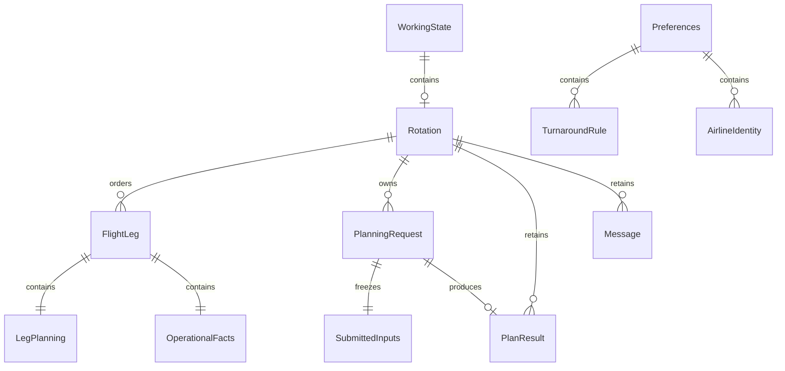

# AutoDispatch — proposed data model

**Review draft, amended 16 November 2026.** Field names and storage shapes remain proposals, not application code or an approved schema. The current review rules in DEC-056–060 and unsuperseded DEC-051–054 are accepted; this does not approve the complete model or close PRE-09. Electron + React + TypeScript is decided; JSON is the preferred persistence direction.

Read alongside the [domain and persistence proposal](domain-persistence-proposal.md) and authoritative [PRD](prd.md). DEC-046/050 record the accepted stack and utility-process/domain/integration separation. This amendment aligns the model with accepted DEC-056–060 while preserving PRE-02/04/09 uncertainties. No service payload fields or endpoints are assumed to be verified.

## Model at a glance

Keep one **Rotation** containing ordered **FlightLegs**, with rotation-scoped **PlanningRequests**, **PlanResults** and **Messages**. Preferences and reusable turnaround rules have a separate lifetime. A leg contains three different kinds of information: editable planning, returned planning results, and observed operational facts.

A stable leg identity survives planning edits. Original ACARS messages belong to the rotation and keep their leg association and frozen context. Planning revisions reject obsolete responses; they do not require historical leg copies, a route-version browser or a complete retained planning graph (DEC-057).

These are plain data objects, not SQL tables or an inheritance hierarchy. All operational objects save together in `working-state.json`. Pure domain modules validate and change them; the utility-process persistence adapter serializes the snapshot. Storage metadata such as checksums belongs to the adapter, not the flight domain. The renderer receives display snapshots, not writable domain objects.

## Common value conventions

| Value | Proposed representation and meaning |
|---|---|
| IDs | Opaque unique strings, generated through a domain port. Stable across restart; never derived from array position, airport or callsign. |
| UTC instant | Full ISO UTC string, e.g. `2026-11-15T13:23:00Z`. Field names identify simulator versus system clock. |
| Flight date | `YYYY-MM-DD`; full event instants still include their own dates, including overnight arrivals. |
| Unknown | Explicit `null`, not zero, empty string or a made-up time. Empty collections use `[]`. |
| Duration | Numeric minutes with a named field; finite and nonnegative. No unspecified time unit. |
| Fuel/weight | `{ value, unit }`, with unit `kg` or `lb`; fuel inputs that permit duration use a tagged minutes alternative. Zero means a supplied zero; null means unspecified/unavailable. |
| Revision | Nonnegative integer; snapshot revision changes per successful save, planning revision per change to relevant effective inputs or invalidation of preparation context. Neither uses simulator time. |
| External reference | Opaque service-provided identifier, nullable. Not interchangeable with our local request or result ID. |

Validate airport/callsign/catalogue values against the relevant accepted rules and verified integration contract. Do not prematurely encode guessed service lengths, identifier formats or unsupported planning options. Raw service DTOs stay in adapters; normalized domain values retain provenance and units.

Telemetry and message read/unread updates do not create new planning revisions or copies of legs. Original message associations survive planning edits.

## Files and top-level ownership

| File | Contents | Lifecycle |
|---|---|---|
| `working-state.json` | Storage envelope plus one nullable rotation and everything needed to resume it | Replaced atomically as described in the persistence proposal |
| `preferences.json` | Independently versioned preferences, turnaround rules, airline identities and non-secret integration references | Survives rotation replacement and clear |
| Optional document files | Immutable OFP documents referenced from the snapshot, if needed | Rotation-scoped; never used to discover or restore a rotation |

The working-state envelope has `schemaVersion`, `revision`, `savedAtSystemUtc`, `rotation`, and adapter-owned integrity metadata. A cleared rotation is explicitly `rotation: null`. Do not retain a deleted-rotation catalogue. The checksum encoding and Windows commit mechanism remain storage design details; a checksum cannot establish whether an old valid snapshot is current.

**Rotation**

| Field | Meaning |
|---|---|
| `id` | Unique working-rotation identity; replacement gets a new ID |
| `started` | True only after the matching first operational OFP successfully completes startup under M16; never inferred from airborne telemetry |
| `aircraft` | Current shared aircraft configuration used for editable legs |
| `legs` | Ordered FlightLeg array; order is stored once, not also in a separate position field |
| `planningRequests`, `planResults`, `messages` | Rotation-scoped collections described below |
| `handover` | Null or `{ inboundLegId, nextLegId, completedAtSimulatorUtc }`; the normal ten-minute due time is derived. Accepted recovery activates immediately instead. |
| `diversionIntent` | Null or `{ legId, intendedAirportIcao }`; separate from planned destination and actual arrival, persisted through restart |
| `recoveryHolds` | Typed holds with the originating leg and any affected next-leg ID |

Derive the active leg from `legs[].lifecycle`; enforce at most one Active leg instead of maintaining a second mutable active-leg pointer. An unstarted rotation has none; a handover interval can also have none. This deliberately simplifies the earlier architecture sketch's active-leg pointer. Startup-in-progress is derived from an unstarted rotation and its first leg's outstanding operational-OFP request, initiated only by Start Rotation.

## Flight leg and planning

**FlightLeg**

| Field | Meaning |
|---|---|
| `id` | Stable leg identity |
| `lifecycle` | `pending`, `active` or `completed` only |
| `planningRevision` | Revision of effective inputs used to associate results |
| `planning` | LegPlanning value object |
| `operations` | OperationalFacts value object |
| `currentOfpId` | Null or latest associated successful operational PlanResult; may be Out of date |
| `advanceResultId` | Null or successful preliminary result for this next leg; persists the automatic-preparation success marker |
| `automaticPreliminaryMessageId` | Null or the automatic message for the current preparation workflow; explicit updates do not replace it. Recovery reset clears this marker, not the original rotation-owned message. |
| `arrivalDispatch` | Null or `{ inboundLegId, requestId, shutdownObserved }`; request ID is nullable until generation is requested |

`arrivalDispatch` tracks one automatic operational-OFP workflow, with no primary/fallback plan categories. Low-speed arrival and shutdown evaluate the same workflow. Saved success prevents another automatic generation even if edits make its OFP Out of date; explicit regeneration is separate. A pending cycle prevents overlapping cycles, but no usable OFP permits bounded retries under DEC-059, including uncertain outcomes. Shutdown does not reset an exhausted budget; user Retry starts a fresh cycle. If a later eligible request uses changed gate timing, capture new immutable inputs and update this reference. `shutdownObserved` remembers a past opportunity, not live proof of ground state or clear holds.

**Accepted recovery clarification (DEC-053/056):** a recovery action creates an ordinary leg with a new ID and fresh planning inputs, without a permanent `recoveryOf` link or special subtype. The original completed attempt remains intact. Acceptance immediately activates the new leg and starts generation with approval-time simulator UTC as requested off-block; no turnaround or ten-minute activation wait applies. Default ATC callsign is the first up-to-six characters of the affected flight's callsign plus R (EZY1234 → EZY123R); optional IATA flight number stays unchanged. Temporary holds identify the arrival requiring a choice until resolved. Normal subsequent-leg behaviour resumes after this explicit activation/filing exception.

**LegPlanning**

| Field | Meaning |
|---|---|
| `originIcao`, `destinationIcao` | Planned airports; actual arrival is stored elsewhere |
| `atcCallsign`, `iataFlightNumber` | Separate identifiers; IATA number nullable |
| `flightDate` | Planning flight date |
| `aircraft` | Copy of effective shared aircraft values for this leg |
| `scheduledOffBlock`, `scheduledOnBlock` | Independently nullable ScheduleBaseline objects |
| `turnaround` | Resolved minutes, source (`override`, `prefixRule`, `default`), and optional source-rule ID |
| `fuelOptions` | Nullable ATC, weather, MEL, extra, contingency and final-reserve inputs with explicit units |
| `weightUnitPreference` | Nullable dispatch preference; never overrides returned OFP units |
| `simBriefOptions` | Only explicitly modelled supported options after PRE-02 mapping; no unvalidated generic settings bag |

A ScheduleBaseline contains `atUtc` and `source` (`manual` or `firstFiled`). An originating result ID may be retained as an audit identifier, but must not require keeping discarded PlanResult data. Preserve the value/source by default through preparation reset; users can change it when planning is editable. Automatic initialization from first Filed is result processing, not a new input revision that immediately makes its own OFP stale. Explicit eligible schedule edits change planning revision when relevant to dispatch. Later Filed values never silently reset Scheduled.

**AircraftConfiguration** contains a tagged selection: either catalogue/manual setup (type, optional subtype/variant references and display labels) or a saved-airframe reference. It also contains optional registration and maximum passenger capacity. Saved-airframe use is optional; do not require unavailable personal-airframe listing. Keep returned/resolved aircraft details in the plan result as evidence of what SimBrief actually used. The exact override semantics of a saved airframe require PRE-02.

**Shared edit rule:** shared aircraft values supply defaults for current editable legs. Applying an edit copies values and increments affected revisions in the same snapshot. Background generation does not block an otherwise eligible edit: invalidate obsolete request context. Operationally locked legs retain their copies. Changing registration cannot rewrite completed history or already submitted inputs. No reusable fleet model is needed.

**Editing eligibility (DEC-058):** first-leg generation blocks UI interaction with a loading overlay while the backend stays responsive. Subsequent generation shows a toast/loading indicator; future pending legs remain editable. Current-leg editing requires fresh grounded/stationary/all-propulsion-engines-off telemetry; APU/external power is allowed. Engine start/taxi-out closes editing, but a return to gate before established airborne flight reopens it, including after an RTO. Preserve original off-block and other actuals. Once airborne or completed, planning stays locked.

Planning edits invalidate affected OFPs/requests. Airport changes outside diversion require explicit regeneration from the earliest viable leg: current if eligible, otherwise next eligible, including affected downstream preparation. Edits alone do not send replacement requests. Keep existing schedules and ACARS history.

## Operational facts, timestamps and holds

**OperationalFacts**

| Field | Meaning |
|---|---|
| `departed` | Durable departure history, including inference from recovered airborne telemetry with unknown off-block. It is not by itself a permanent edit lock: a pre-flight return to gate may reopen edits. |
| `airborneEstablished` | Durable flight context and permanent planning-lock cause; permits later valid after-flight completion without requiring every phase |
| `phase` | Nullable confirmed phase from M04/M16; initially unknown, never a substitute for lifecycle |
| `actualOffBlockUtc`, `actualTakeoffUtc`, `actualLandingUtc`, `actualOnBlockUtc` | Independently nullable simulator-observed event times |
| `filedOffBlock`, `filedOnBlock` | Independently nullable `{ atUtc, ofpId }` values from the current operational OFP mapping |
| `arrival` | Null before arrival; otherwise `{ episodeId, outcome, actualAirportIcao, identificationSource }` |
| `phaseContext` | Only bounded confirmed context required by the eventually selected detector, e.g. operating altitude; exact shape waits for PRE-04 |

`arrival.outcome` is `destination`, `return`, `diversion` or `unresolved`. `actualAirportIcao` is null when unresolved. `identificationSource` distinguishes validated automatic identification from exceptional user confirmation; numerical confidence scores are not invented. An arrival episode ID distinguishes confirmed arrival opportunities when implementing the agreed bounce/go-around rules. The detector's re-entry/reset rules remain PRE-04 work; raw brief ground contacts do not create completed arrivals.

The three time concepts remain separately persisted: Scheduled in planning, Filed with its OFP provenance, Actual in operations. The display combines them. Returning an OFP updates Filed but cannot reset Actual. A current plan arriving after departure is still associated; `departed` remains true. A response must match the current revision/context; request completion does not override operational editing restrictions.

Hold variants:

- `declaredDiversion`: originating leg and intended airport from `diversionIntent`; pauses onward workflow until cancellation or actual-arrival resolution.
- `arrivalAirportUnresolved`: originating inbound leg; awaiting exceptional airport confirmation.
- `arrivalRecoveryChoice`: originating return/diversion leg; onward automation suspended; prompt visibility follows completion.
- `manualRepositionAwaitingResume`: originating leg and target next leg; only explicit Resume releases it.

Represent holds explicitly rather than one `automationPaused` boolean. Clearing an airport hold must not accidentally clear a manual-reposition hold. Complete the inbound despite unresolved airport identity, but do not clear a final rotation or activate/dispatch onward until the applicable outcome is resolved. If confirmation establishes a normal final arrival after completion, normal clearing follows.

Normal handover anchors to inbound actual completion, not restart time. Due time is completion plus ten simulator minutes. Consume handover and activate its target in one snapshot; early qualifying departure additionally closes editing. Recovery acceptance instead activates its new leg immediately. Reordering/removal reconciles handover references and continuity atomically. No departure is recorded during a manual-reposition hold. Use actual arrival at the completed-history boundary, without rewriting the planned route; future legs connect by planned airports. Intentional gaps require manual reposition/Resume.

**Ordering during planning (DEC-058, superseding DEC-052):** first-generation overlay blocks edits. During subsequent generation, permit otherwise eligible insertion/removal/reordering; atomically invalidate affected planning revisions and captured inbound/target context. Preserve continuity and explicit holds. Reject obsolete callbacks at the response boundary rather than assuming remote cancellation. Normal handover/departure alone does not invalidate a correctly associated result. Matching only leg ID without revision/context is insufficient.

**Diversion intent and preparation reset (DEC-056/057):** before confirmed touchdown, users may declare, change or cancel an intended airport while retaining the original planned route. Pause onward planning, messaging/retries, timers and activation; monitoring/actuals continue. Preserve enough current work to resume from the paused point on cancellation, subject to normal eligibility and unrelated holds. No repeated successful steps.

Actual arrival determines normal arrival, return or diversion, regardless of declared intent. Landing at the original destination resolves intent through normal arrival. Unknown airport retains its hold. Declared and automatically detected abnormalities converge on the same recovery choice at stationary/full shutdown. An unanswered choice, elapsed time, relocation or restart never releases the hold.

Accepting recovery commits leg insertion/activation, resolved-hold release and preparation reset together. Keep completed history, remaining leg identities/user inputs, Scheduled baselines by default and all original ACARS audit messages. Discard remaining generated plans/preliminary data and obsolete request state; increment affected revision/context guards so late responses cannot repopulate them. A fresh workflow may generate a fresh automatic message. This reset is distinct from cancelling intent, which resumes paused work. Skipping recovery creates no leg and retains manual-reposition suspension until explicit Resume.

## Requests and returned plans

Keep requests separate from results. An acknowledgement is neither an OFP nor commencement. These are domain-side records, not claims about external API field names.

**PlanningRequest**

| Field | Meaning |
|---|---|
| `id`, `rotationId`, `legId` | Local association; results must match all applicable identities |
| `kind` | `advancePreparation` or `operationalOfp`: the requested planning outcome, not the reason it was triggered |
| `planningRevision`, `submittedInputs` | Frozen effective leg/aircraft values plus resolved request-time readiness, taxi/turnaround inputs and their provenance |
| `eligibilityContext` | Captured startup-first-leg or inbound/next-leg identities checked under DEC-058; local coordination metadata, not an additional plan-kind enum or assumed service field |
| `state` | `prepared`, `possiblySent`, `succeeded`, `definitiveFailure` or `uncertain` |
| `attemptCount` | Initial attempt plus up to three automatic retries for this cycle; retained across restart, no unlimited attempt log |
| `attemptToken` | Correlation for a network invocation within this request/cycle; not a provider idempotency key |
| `createdAtSystemUtc`, `lastAttemptAtSystemUtc`, `finishedAtSystemUtc` | Service/diagnostic times, with nulls where not applicable |
| `serviceReference`, `resultId` | Nullable verified external reference and local result association |
| `failure` | Null or normalized safe error category/details; never credentials or a whole unredacted response |

The coordinator evaluates eligibility at the relevant trigger; it does not classify flight plans by trigger. Startup follows the unstarted-rotation rule. Arrival, shutdown, manual generation, regeneration and generation for a newly added recovery leg all request an operational OFP. A verified same-plan editing API may require an explicit target service-plan reference in submitted inputs; that is an adapter contract detail, not a reason to retain the larger trigger enum. Advance preparation remains distinct even if the eventual supported service workflow implements it using a saved plan.

One current generation cycle owns its frozen inputs and attempt accounting; it does not lock eligible planning edits. DEC-059 permits up to three retries after the initial attempt when no usable OFP arrives, including timeout/lost/corrupt output. Uncertainty remains uncertainty even though retry is allowed. Adopt one valid result matching current rotation/leg/revision/context and cycle; stop unsent retries and disregard additional/obsolete results. Possible duplicate remote SimBrief plans are accepted in this degraded case. A user Retry after exhaustion starts a fresh cycle with latest confirmed inputs and a fresh budget; preserve input throughout. Provider limits, timing/backoff and usable-result validation remain PRE-02 work.

`prepared` means the possibly-sent marker has not committed and the adapter has not been called under the write-before-send protocol. On restart, possibly-sent becomes uncertain and follows DEC-059 within the saved attempt budget; it must not become fabricated failure or success. Local request/attempt IDs provide correlation only, not service-side idempotency. Known successful work is not automatically repeated. Hoppie uses the separate conservative policy below.

**PlanResult**

| Field | Meaning |
|---|---|
| `id`, `requestId`, `legId`, `planningRevision` | Immutable local association |
| `kind` | `preliminary` or `operationalOfp`; a preliminary result never starts the rotation |
| `servicePlanReference`, `receivedAtSystemUtc` | Nullable service identifier plus receipt time |
| `aircraft`, `route`, `flightIdentifiers` | Relevant returned identities, normalized and checked against the request |
| `filedTimes`, `taxiInMinutes`, `cruiseAltitude` | Nullable verified planning data with explicit event basis and units |
| `plannedPassengers`, `fuelAndWeights` | Returned planning values and units, not aircraft loading or actual uplift |
| `validationIssues` | Capacity/association/field validity findings; never silently clamp SimBrief values |
| `documentReference` | Optional rotation-scoped document reference; no assumed permanent service URL |

Fuel fields must distinguish next-leg block fuel, inbound planned burn and estimated arrival fuel, with destination/alternate basis and source association. Exact mapping is deliberately left to PRE-02/question 22; missing values remain null, with explanatory availability metadata where needed. An association mismatch cannot become the leg's current OFP. Whether a returned capacity violation blocks further dispatch use is not settled by inventing a new validity enum; follow the eventual verified validation policy under M08.

Retain results needed by current operations, completed-leg history and known-successful workflow markers. No full superseded-plan archive or request/result graph is needed solely to explain old messages. Recovery resets remaining generated preparation while retaining Scheduled values and self-contained ACARS audit history. Required live references still resolve; prune unreferenced records and optional documents after the committed change. Ordinary edits may leave an existing OFP visibly Out of date until explicit regeneration.

An already-started rotation, including an accepted recovery leg, can continue monitoring if planning fails; unavailable planning figures stay unavailable. First startup still requires a matching OFP. No new ordinary attempts once airborne, but a matching already-sent result may attach without resetting events.

## Messages and Hoppie submissions

**Message** contains `id`, `kind` (`automaticPreliminary` or `requestedUpdate`), `aboutLegId`, a frozen upcoming-flight identity/route summary, `inboundLegId`, `recipientCallsign`, frozen `senderCallsign` using the preferred `AD<current inbound ATC callsign>` format subject to DEC-055 validation, immutable `body`, optional source revision/result IDs as audit labels rather than required retained records, `createdAtSimulatorUtc` where valid, `createdAtSystemUtc`, local `read`, and `submission`.

`submission` contains `state` (`notSubmitted`, `possiblySent`, `accepted`, `definitiveFailure`, `uncertain`), a local attempt token/count, optional safe service reference/error, and system-time attempt/acceptance timestamps. Not configured or transmission disabled leaves it not submitted; the current reason is derived from settings. It is not a mandatory delivery backlog. Whether enabling Hoppie later offers submission of existing messages is separate UI/policy work, not automatic behaviour introduced here.

Create the message and its automatic-message marker together before submitting. Acceptance ends retries. Local read/unread never means cockpit read, delivery or acknowledgement. Freeze both sender and inbound recipient callsigns even if the next leg subsequently activates. Under DEC-055, an explicit callsign-conflict rejection permits bounded delayed retries of this same message; ambiguous outcomes must not cause blind retries. Retry timing, limits and expiry/cancellation remain PRE-06 design work; exhaustion preserves the local log without blocking the rotation. Ordinary edits do not rewrite a previously generated message or cause another automatic one. Accepted recovery resets remaining workflow markers and may generate a fresh automatic message, while retaining original messages and outcomes. Historical submissions cannot resume retries or suppress the rebuilt workflow's message. Do not apply SimBrief's retry budget to Hoppie.

**Removal and retained history (DEC-051 as simplified by DEC-057):** when an unflown leg is explicitly removed, retain generated message content for the rotation lifetime. Its frozen identity/route summary explains the message without retaining a hidden operational leg. Apply all cleanup in the same snapshot as the removal:

- Allow eligible removal during subsequent generation; invalidate affected outstanding work and reconcile live references atomically under DEC-058. The first-generation overlay still blocks interaction.
- Retain original messages with frozen identity/route, body, timestamps, sender/recipient and submission outcomes. Discard unneeded planning records; messages and retained schedule baselines must remain understandable without live links to discarded requests/results. External document cleanup follows snapshot publication.
- Allow historical identifiers in messages to refer to removed legs or discarded revisions/results. Live current-plan, handover, arrival-dispatch and recovery-hold targets must still resolve; no hidden operational leg is retained.
- Reconcile live handover/target references and airport continuity before committing. Removing a target must not silently release an existing manual-reposition or arrival-recovery hold; retain the originating hold and require the applicable explicit recovery choice/Resume for its valid replacement target. Reject the edit if no valid reconciliation is available.
- Retained records cannot make a removed leg eligible, produce another automatic message, submit another network request or recreate it from a late callback. Historical success evidence is not a queue.

## Preferences and reusable rules

The preferences payload contains:

- Dispatch defaults: automation controls, proximity threshold (accepted default 20 minutes), default turnaround, taxi-in fallback and optional weight-unit preference. Other numerical defaults are not invented here. The exact mapping of the PRD's general and arrival automation controls should avoid redundant flags.
- Presentation/notifications: local-time display preference and message/OFP/failure notification choices. Persisting the board preference does not move its control into Settings.
- `turnaroundRules`: `{ id, callsignPrefixes, turnaroundMinutes, airlineId }`, with nullable airline membership.
- `airlines`: `{ id, name, icaoCode, iataCode }`, optional identity grouping; rule values are owned once by turnaroundRules rather than duplicated in airlines.
- Non-secret integration account identifiers/references and Hoppie-enabled preference. No authentication tokens or logon keys.

One rule can match EZY and EJU without an airline record. A per-leg override wins over a matched rule, which wins over the default. Longest matching prefix with rejection of equally specific conflicting rules remains a proposal. Applying changed profiles to existing editable legs is explicit; completed history never resolves values again from these mutable rules. Credentials follow the authoritative DEC-050 main-process storage boundary; domain objects contain no platform secret-store handles.

## Derived/transient state and validation

Do **not** persist additional authoritative copies of: editability, active-leg ID, next eligible leg, Out of date flag, UI dispatch label, unread count, timing status/colour, readiness estimate or handover due time. Derive them from the fields above. Out of date compares the associated result's input revision with the leg's effective planning revision. Domain rules still distinguish known result success from present freshness.

Keep live telemetry, freshness/session sequences, connection/authentication health, short confirmation windows, network timeout handles and UI selection transient. Persist only confirmed detector context necessary to resume; a saved phase/engine reading cannot prove current readiness. No telemetry samples are required to rebuild the rotation.

Validate these invariants on commands and snapshot load:

1. At most one working rotation and one Active leg; no Active leg in an unstarted rotation.
2. Current operational references resolve within the same rotation; IDs are unique. Historical message identifiers may refer to removed legs or discarded planning records under DEC-057; frozen message context remains readable and cannot drive operational actions.
3. Current-leg editing requires parked/engines-off telemetry and no established airborne flight; a pre-flight return to gate can reopen it. Airborne/completed planning remains locked. Request completion cannot reset departure/actuals or override these conditions.
4. Completed means valid after-flight grounded/stationary/all-engines-stopped completion, not just phase PARKED. Missing touchdown remains allowed.
5. First successful matching operational OFP gates commencement; normal later handover has no new OFP prerequisite. Accepted recovery immediately activates the fresh leg at approval time, with no turnaround or ten-minute wait.
6. One automatic message per eligible subsequent-leg workflow; none for the initial leg. Accepted recovery resets remaining preparation and permits fresh workflow messages while retaining all prior messages. Ordinary edits/restarts do not reset this allowance; accepted Hoppie messages never resend.
7. Actual times are independent and non-editable. Do not reject recorded history merely because a manual simulator-clock change makes timestamps non-monotonic; planning-time conflicts are validated separately.
8. Clearing removes all rotation-owned state in one snapshot, preserving preferences/credentials. Stale callbacks cannot repopulate it.
9. Eligible ordering edits invalidate affected request revisions/context atomically, preserving continuity and holds. Old responses cannot attach plans, create messages or dispatch after reset/removal.
10. A SimBrief cycle has at most four attempts and adopts one valid matching result; restart retains budget/outcome. Explicit Retry starts a fresh budget after exhaustion. Uncertain Hoppie outcomes never trigger blind resend.
11. Diversion intent and all recovery holds restore from working state; elapsed time or aircraft movement cannot release them.

## Commands and persistence boundary

DEC-060 requires enum commands with command-specific typed, runtime-validated payloads. The backend checks eligibility and current identity/revision/context, builds a complete next state, commits it transactionally, then publishes its snapshot and initiates dependent effects. Capture time/identifiers once for deterministic execution; duplicate command delivery must not repeat the committed action. This is command idempotency, not business version history. Concrete payload/schema details remain proposed.

Save failure shows an error, retains committed state and sends no dependent request; no unsaved operational mode. Form input may remain available for retry without being represented as saved. Unreadable working state is preserved with a recovery error and a fresh-rotation option. Settings/credentials are separate. JSON remains preferred pending bounded validation; SQLite is fallback if unsuitable. No automatic backend-restart or heartbeat framework is added.

## Concrete review examples

| Situation | What changes / what stays |
|---|---|
| Completed A used registration G-AAAA; shared configuration changes to G-BBBB | Rotation default and eligible B/C planning copies change; A and old request snapshots retain G-AAAA. If B is generating and otherwise editable, invalidate its old request revision; do not rewrite submitted inputs. |
| Scheduled 13:00; returned Filed 13:20; observed Actual 13:23 | Store all three independently; derive +23-minute actual departure deviation. |
| B departs while its OFP is pending | Taxi-out closes editing and established airborne flight locks it permanently. Request retains submitted revision; a matching response updates OFP/Filed without clearing actuals or overriding editability. |
| A completes at 14:00Z; B departs at 14:06Z | Consume A→B handover and activate/lock B in one save. The derived 14:10 deadline later does nothing. |
| Hoppie accepted a message, then the app restarts | Accepted submission and automatic-message marker restore; no resend. A lost unsaved outcome instead restores uncertainty. |
| Final normal leg completes | Envelope retains its format/revision but rotation becomes null. Preferences and secret storage survive. |
| Remove a pending leg after its preliminary message/result exists | Remove the operational leg; retain the original message with self-contained context; discard unneeded planning provenance. The snapshot reloads successfully, historical leg IDs do not recreate the leg, and no further dispatch occurs for it. |
| Insert/reorder a leg ahead of the target of an unresolved planning request | Permit an otherwise valid edit during subsequent generation, invalidate affected context/revisions and disregard the old response. Startup overlay still blocks edits. |
| Taxi out, then return to gate and shut down before flight | Reopen planning edits; retain off-block/actuals. A planning change invalidates OFP and requires explicit regeneration. Airborne history would prevent reopening. |
| Declare C during A → B, then cancel before touchdown | Preserve planned B; pause onward workflows, then resume from the paused point without repeating known success. |
| Divert to C, shut down at 14:00, accept C → B at 14:25 | Save fresh leg/activation/reset/hold resolution together; requested off-block is 14:25. Default EZY1234 to EZY123R, IATA unchanged. Preserve original A → B with actual C and ACARS history. |
| Reset B → D preparation after accepting C → B | Keep B → D inputs/schedules and all messages, discard generated preparation, reject late old responses; a fresh workflow may issue a new automatic message. |
| No usable OFP through four attempts | Preserve inputs and show Retry; a manual retry starts a fresh budget. First startup remains unstarted; an already-started rotation can continue monitoring. |

This draft can be reviewed without settling every external field. Remaining targeted choices are profile-application/conflict policy, exact supported SimBrief inputs/outputs, retry timing/response validation, concrete IPC payloads and bounded detector context. Product retry/retention/editing policy is settled by DEC-056–060; storage reliability remains unproven. JSON integrity/commit details remain in the persistence proposal. Next implementation artefacts, after model review, would be TypeScript domain types, a runtime snapshot schema and fixtures for these examples; none are implemented here.
