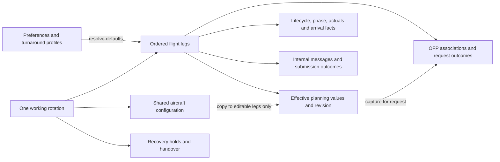

# AutoDispatch — domain, state and persistence proposal

**Status: Domain, state and persistence recommendations proposed for review. Electron + React + TypeScript is the decided stack.** 15 November 2026.

**Follow-on model:** [Data model proposal](data-model-proposal.md) defines the proposed JSON objects, fields and invariants. On that pass, the authoritative PRD also contained accepted DEC-050 for domain/integration separation within the utility process and credential operations in the main process. That newer decision supersedes this document's earlier references to the process model as unapproved; storage details and the data model remain proposals. The follow-on model derives the active leg and handover deadline rather than storing duplicate pointers/timestamps.

Basis: [PRD v0.4](prd.md), especially M01–M06, M09, M14–M17, AC01–AC16, PRE-02/PRE-04/PRE-09 and the decision record through DEC-049. The PRD remains authoritative. This document does not change its identifiers, statuses, outstanding questions or research evidence, or claim that a pre-implementation action is complete.

Repository inspection: `E:\Projects\AutoDispatch` on `main` and this `Domain-Modelling-and-Persistence` worktree were clean at `ab9f2f2`. Their PRDs matched byte-for-byte (SHA-256 `0F27EDC95806E2C10E63AF1A5AEE1746C259414A434DCB57F55141A7BA0BA130`). The older `MSFS-AutoDispatch-Design-and-Planning-Session` worktree was at `affa401`; it was not used as the current baseline. The v0.3 snapshot comparison confirms v0.4's consolidation role. This proposal is a new file in the dedicated worktree; no shared PRD or other discovery document is edited. Remote branch freshness was not checked.

**Stack clarification:** the final discovery check found a concurrent change to DEC-046 in the authoritative repository's PRD, marking the stack Accepted. The product owner subsequently explicitly confirmed Electron + React + TypeScript as decided, resolving the initial task brief's unapproved-stack framing. This proposal uses that decided stack without reopening the comparison. The confirmation does not by itself approve the separate utility-process design or the domain/persistence recommendations below. Neither PRD was edited by this pass; the comparative claims added to DEC-046 were not independently validated here.

## Recommendation and material findings

Use one backend-owned working-rotation model, one serialized transition coordinator and structured JSON snapshots. Keep settings/profiles outside the rotation's deletion scope and secrets outside ordinary operational storage. Persist meaningful changes and external-action outcomes, not a telemetry stream. No SQL requirement has been demonstrated for the MVP. No event sourcing, CQRS, remote database or durable general-purpose queue is needed.

Three findings drive this recommendation:

- A mutable shared-aircraft reference would rewrite completed history. Each leg needs its own effective planning values, frozen at departure, and each request needs its submitted input snapshot.
- Lifecycle, phase, planning locks, dispatch outcomes and recovery holds are independent. One large “flight status” enum cannot express the accepted combinations safely.
- Crash recovery must preserve both operational facts and knowledge about external effects. A complete snapshot replacement can keep related local changes together; neither files nor database transactions prove whether a remote request succeeded when its response was lost.

**Revised following the product owner's preference and filesystem research:** prefer JSON for this single-document workload, subject to validating Windows write/recovery behaviour. SQLite is a fallback if a suitably reliable file writer becomes more complicated than adopting its transaction mechanism, or measured workload changes justify it. This supersedes this proposal's initial SQLite recommendation; it does not claim that JSON writing is already validated. Electron + React + TypeScript is decided; a separate Node utility process remains the proposed backend execution model.

## Core domain and lifetime

These are domain relationships, not a required class hierarchy or one-table-per-box schema.

| Concept | Minimum durable content | Invariants / responsibility |
|---|---|---|
| Working rotation | Unique ID, state revision, started flag, shared aircraft values, ordered leg IDs, active-leg ID if any, handover and holds | Zero or one working rotation; at most one Active leg. Between inbound completion and outbound activation there may be none. Creation is not commencement. |
| Flight leg | Stable ID, Pending/Active/Completed lifecycle, planning values/revision, phase, operational facts | Identity is independent of list position/callsign. Recovery creates an ordinary new leg without a durable lineage link, per the follow-on model review; original attempt remains immutable. Manual skip/removal never fabricates a completed flight. |
| Aircraft / planning values | Catalogue type/variant or optional saved-airframe reference, registration, passenger ceiling; route, identifiers, date, schedule, fuel/options/units and resolved turnaround | Aircraft configuration is shared as an editing convenience, not a live reference from historical legs. SimBrief remains planning authority; no local fuel-planning engine. |
| Event times | Separate nullable Scheduled, Filed and Actual off/on-block; nullable Actual liftoff/touchdown; Scheduled source; Filed OFP reference | Full UTC dates, not time-of-day alone. First available Filed initializes an absent Scheduled value; later OFPs do not reset it. Manual schedule edits obey locks. Actuals are never user-editable or inferred from phase labels. |
| Operational facts | Permanent departed flag, established airborne/after-flight context, confirmed phase, recorded actuals, arrival episode/outcome and actual airport | A recovered airborne leg can be locked with unknown off-block/liftoff. An initial PARKED phase cannot complete a fresh leg. Phase changes and RTO cannot erase departure history. |
| Arrival and handover | Destination/return/diversion/unresolved outcome, airport evidence or manual confirmation; inbound/outbound IDs, completion simulator UTC and activation due UTC; explicit holds | Landing/completion can be recorded while airport identity is unresolved. Holds distinguish unknown airport, recovery choice and manual reposition awaiting Resume. Activation never bypasses them. |
| OFP / advance result | Local association ID, service ID if supplied, leg/request/input revision, submitted inputs, relevant returned plan values/units and accessible OFP content/reference | Preview is distinguished from operational OFP. Keep the last successful plan visibly Out of date when applicable. A service “latest plan” alone is insufficient response association. |
| External action | Local request ID, rotation/leg IDs, action kind, input revision, attempt/outcome, service reference if available, relevant system timestamps | Prepared, possibly sent, successful, definitive failure and uncertain are internal knowledge states, separate from the PRD's dispatch labels. Planning kind distinguishes advance preparation from operational OFP. Low-speed arrival and shutdown evaluate the same generation workflow; they are not plan/request categories. Local IDs do not imply service idempotency. |
| Internal message | Immutable content, message ID, upcoming-leg association, inbound recipient callsign snapshot, sender, timestamp with clock source, local read state, automatic-message marker, submission outcome | One automatic preliminary message per eligible subsequent leg; none for the first. Explicit updates are distinct messages. Hoppie acceptance is terminal for retries, not cockpit delivery. |
| Preferences and profiles | Dispatch preferences, notification/units/taxi fallback, local-time display preference; standalone prefix rules, optional airline grouping, defaults and per-leg overrides | Survive rotation clear. Resolve applicable rule values into each leg; do not recalculate completed history from mutable profiles. Credentials are referenced, not embedded. |

**Shared edits:** copy a new shared configuration to Pending and Active pre-departure legs only. Validate the whole affected set, increment each affected planning revision, and mark affected existing OFPs Out of date in one transition. Reject the edit if it would change any request-locked leg; do not silently apply it to only part of that set. Departed/completed legs retain their copied configuration. Other independent eligible leg fields remain editable. Resolve profile/default changes with the same historical protection; proposed default policy is that profile edits affect new legs, while applying them to existing editable legs is explicit. Prefix collision precedence needs a deterministic rule (propose longest prefix; reject equally specific conflicting rules).

**Stored versus derived:** persist lock causes, not an independently mutable `editable` flag. Derive eligibility, Out of date from revision association, unread counts, departure/arrival deviations, timing colours/status and readiness from saved facts. Persist confirmed phase and sufficient phase-classifier context, such as a confirmed operating-altitude reference if the eventual descent rule needs it. Short confirmation windows, position/speed/fuel samples, connection health and UI selection are transient. Restart invalidates telemetry freshness and re-establishes ordinary confirmation checks; last-known phase is not proof of live telemetry. No raw sample archive is required.

Readiness follows M05: filed gate time (or filed landing plus taxi-in), then observed touchdown plus taxi-in, then observed gate arrival without another taxi allowance; add outbound turnaround. With a Scheduled departure, estimated departure is the later of schedule and readiness. The proximity calculation is solely an airborne preparation trigger. Freeze the timing/configuration inputs used by a request so later preferences cannot change its recorded meaning.

## Authoritative state and coordination

The backend coordinator owns all operational mutation. Its in-memory model is the working copy of the last committed state; durable storage is the restart authority. Presentation submits typed commands and displays versioned backend snapshots. Simulator and service adapters translate observations/results; they do not change legs or initiate follow-on requests themselves.

For each input: validate identity and freshness, evaluate a short synchronous transition against current state, commit all related durable changes in one snapshot replacement, then publish the result and execute authorized effects. Network calls occur outside the storage operation. Awaiting persistence must serialize subsequent mutations too; a JavaScript event loop alone does not prevent asynchronous races.

| Input / transition | Owner and guard | Atomic local change / consequence |
|---|---|---|
| Start Rotation | Coordinator; explicit command, M16 readiness, first pending leg | Save startup request and lock. Matching successful OFP saves plan/times and starts rotation/activates first leg under ordinary eligibility. Acknowledgement/failure does not. No special readiness-loss workflow (DEC-048). |
| Planning edit | Coordinator; expected state revision and all lock checks | Update affected values/revisions and freshness together; no implicit regeneration. |
| Confirmed departure / later airborne observation | Classifier proposes; coordinator applies only to tracked active or eligible preloaded leg | Permanently lock planning; record only observed timestamps; preserve phase skipping. |
| Airborne proximity qualifies | Coordinator; current valid airborne telemetry, eligible next leg, no successful preparation already | Reserve one preparation action; subsequently store available preliminary content and automatic-message marker together, before any Hoppie submission. Independent of displayed phase. |
| Arrival / low speed | Coordinator; confirmed landing, current ground state, identified normal destination, automation enabled | Establish outcome/holds before considering next-leg dispatch. Reserve primary action only if eligible and not already pending/successful. |
| After-flight stationary/full shutdown | Coordinator; grounded, known all engines stopped, established flight context | Complete inbound, save gate time, establish handover deadline or recovery choices; evaluate fallback. Normal final leg clears atomically instead. |
| Activation due / early departure | Coordinator; matching handover, pending next leg, fresh valid telemetry, no holds | Consume handover once; activate, and for early departure also lock planning and enter DEPARTING. No OFP requirement added to subsequent-leg activation. |
| OFP / Hoppie response | Coordinator; matching current rotation, leg, request and input identity | Save outcome and associated plan/message changes together. A repeated terminal result is a no-op. |
| Disconnect / backend restart | Backend adapters and coordinator | Invalidate live telemetry; retain durable progress/holds, reconnect automatically, resume from valid observations. |
| Replace / clear | Coordinator; required user confirmation or normal final completion | Delete rotation-scoped content and invalidate its identity in one commit; retain preferences/profiles/credential references. |

Use a small in-memory FIFO of commands/results, not a broker. Bound ingress and UI publication; do not discard telemetry edges needed by confirmation rules when reducing sample rate. Sequence observations by connection-session ID and adapter sequence number, not simulator UTC, which may move backwards. Reject old-session and stale observations. User commands carry expected state revision; replayed mutations must be rejected or return the existing result, never automatically reissued after IPC reconnection.

Within an observation, precedence is: validate freshness/context; establish departure/arrival facts and recovery holds; apply completion/handover; evaluate eligible external effects. Airport identification pending means no onward action, not an assumed destination. Before sending a prepared effect, recheck current identity/holds/eligibility. No design can retroactively cancel a remote effect already sent before later evidence arrived.

**Process constraint:** exactly one backend owner/writer per user data directory, including across application instances and utility-process restarts. The shell must confirm the old owner has exited before replacement, supervise backend health and disable operational commands while unavailable. A renderer reload must not stop monitoring. Database locks alone do not prevent two owners issuing remote requests. Electron documents Node-enabled utility processes, message ports and exit events; it does not supply these domain guarantees ([utilityProcess documentation](https://www.electronjs.org/docs/latest/api/utility-process)). Domain functions depend on telemetry, clock, persistence and integration interfaces, not Electron/React APIs.

## Required race outcomes

| Race | Proposed handling preserving accepted behaviour |
|---|---|
| Primary arrival request, then shutdown | Shutdown completes inbound independently. Successful primary suppresses fallback permanently for that opportunity, even if its OFP later becomes Out of date. Pending primary prevents concurrent fallback. Retain shutdown eligibility; after definitive primary failure, reevaluate fallback with current telemetry/holds. An uncertain primary is not permission to retry. |
| OFP arrives after departure | Match captured revision/request; associate returned OFP and apply Filed/baseline rules. Keep recorded events, lifecycle and permanent lock. No ordinary new generation after departure. |
| Early departure races ten-minute timer | Both target the same handover identity. First activation consumes it. If timer wins, departure still applies to the now-Active leg; if departure wins, timer is a no-op. Never activate a second leg. |
| Diversion/unknown airport coincides with low speed or shutdown | Commit hold before effects; suppress both automatic dispatch and activation. Completion still occurs. Normal final clearing requires confirmed normal arrival; unknown/abnormal final arrival remains recoverable. |
| Shared-aircraft edit during generation | Reject the entire shared edit if it would alter the request's affected inputs. No in-flight request mutation; unrelated editable leg inputs remain available. |
| Late response after replacement/clear | IDs never reused; reject result before attaching content. Best-effort local abort may reduce work but is not remote cancellation. No old rotation, OFP or message is recreated. |
| Crash after remote send, before saving outcome | Restore as uncertain; no blind retry and no fabricated success/failure. A locally known-successful, committed result is never retried. A success received only in memory may be lost; this is the unavoidable remote/local boundary. |

Persist action preparation before dispatch. Immediately before invoking the adapter, commit a “possibly sent” marker. A crash while still Prepared proves no send occurred under this protocol and allows reevaluation only when recovery trusts the latest committed snapshot, not an older backup. A crash after the marker is conservative uncertainty, even if the network call had not actually begun. Save a successful result and all its consequences in one snapshot. This is a small current-action record, not event sourcing or an eventual-delivery queue.

For uncertain SimBrief results, propose retaining the affected temporary lock and suppressing automatic retries until definitive evidence exists; monitoring continues. For uncertain Hoppie submissions, keep the log usable and suppress automatic resubmission. These are provisional conservative treatments, not a completed recovery UX or accepted indefinite-lock policy. PRE-02/question 21 and PRE-06/question 5 must establish reconciliation and escape options. A supported service lookup, cancellation or idempotency facility may improve this only if verified; none is assumed. Definitive request-boundary failures can be retried within a bounded policy, rechecking eligibility; retry limits/backoff remain to agree.

## Persistence comparison

Both options are local files. Neither implies a backend service.

| Concern | Structured snapshot with safe replacement | SQLite embedded database |
|---|---|---|
| Related changes | One complete versioned envelope can atomically represent rotation, actions and messages; splitting these among files creates coordination work | One transaction updates related records and deletes rotation data together |
| Interrupted writes | Write same-directory temporary file, flush, validate, replace, handle failure states; retain a validated fallback only with explicit freshness/clear rules | Journal recovery handles incomplete transactions, within documented OS/storage assumptions |
| Frequency / overhead | Entire envelope rewritten per durable transition; credible for one small rotation, but message/OFP growth increases writes | Changed records/pages written plus journal/sync overhead; no server process. Actual latency/resource advantage requires measurement |
| Recovery complexity | Application owns generation selection, checksums, replacement errors and safe handling of older copies | Application still validates domain/schema and uncertain actions; engine owns transaction rollback |
| Schema changes | Explicit envelope version, validation and copy/migrate/replace | Explicit schema/payload version and transactional migrations; SQL does not migrate domain meaning automatically |
| Diagnostics | Human-readable, but easy to edit into inconsistent state; redacted support export still needed | Inspection requires tooling; provide redacted structured support export and bounded logs |
| Packaging | Built-in serialization/filesystem APIs, possibly additional Windows replacement handling | SQLite binding/runtime support and deployment/licence checks; exact Electron Node version matters |
| Lifetime boundaries | Separate preferences file is practical, but current/backup rotation clearing needs careful ordering | Settings/profiles and rotation records share a file while remaining in separate deletion scopes |

Node documents that `writeFile` can perform multiple writes and concurrent writes must be serialized. Its `flush` option flushes file data; that alone is not a complete replacement/recovery protocol ([Node filesystem documentation](https://nodejs.org/api/fs.html)). Windows `ReplaceFileW` has documented partial-failure outcomes and does not support its `REPLACEFILE_WRITE_THROUGH` flag; do not claim “rename means power-loss safe” without validating the actual mechanism ([Microsoft ReplaceFileW](https://learn.microsoft.com/en-us/windows/win32/api/winbase/nf-winbase-replacefilew)).

### Filesystem research finding — 15 November 2026

**Achievable in principle: yes. Demonstrated in the packaged app: not yet.** The rotation is a cohesive document loaded into memory, with one writer and no historical query workload. Microsoft explicitly describes writing a new file and replacing the original as an approach for document-like atomic updates. It separately cautions about maintaining consistency across structured datasets. Keeping the operational state together avoids that latter multi-file problem; this is a design inference, not Microsoft validation of AutoDispatch. Do not adopt Transactional NTFS: Microsoft recommends alternatives ([Microsoft guidance](https://learn.microsoft.com/en-us/windows/win32/fileio/deprecation-of-txf)).

Atomicity means recovering a complete old or new state. Durability means an acknowledged save survives the specified failure. They are different promises. Windows normally buffers writes, and exposes `FlushFileBuffers` to flush buffered file information; neither JSON syntax nor successful parsing establishes durability ([file caching](https://learn.microsoft.com/en-us/windows/win32/fileio/file-caching), [FlushFileBuffers](https://learn.microsoft.com/en-us/windows/win32/api/fileapi/nf-fileapi-flushfilebuffers)).

The inspected libuv `v1.x` Windows source uses `MoveFileExW(..., MOVEFILE_REPLACE_EXISTING)` for rename, without `MOVEFILE_WRITE_THROUGH`; its file-sync implementation calls `FlushFileBuffers`. Thus flushing a temporary file and renaming it through Node is not, from this evidence alone, a proven durable replacement across power loss. This is a source observation, not a demonstrated failure. Verify the exact libuv bundled with the selected Electron release ([libuv source](https://raw.githubusercontent.com/libuv/libuv/v1.x/src/win/fs.c)). Microsoft documents a separate write-through flag for `MoveFileExW`, but that documentation does not itself prove a complete AutoDispatch commit protocol ([MoveFileExW](https://learn.microsoft.com/en-us/windows/win32/api/winbase/nf-winbase-movefileexw)).

| Failure / requirement | JSON feasibility and remaining qualification |
|---|---|
| Normal close and restart | Straightforward: load the validated current snapshot; do not rely on an exit-time save. |
| Backend/application killed during save | Credible with serialized same-directory replacement: old current remains until replacement, and the candidate is complete before publication. Must test every interruption boundary on Windows. |
| Related lifecycle/action/message changes | Put them in one snapshot; no independent writes to `legs.json`, `requests.json` and `messages.json`. One publication includes all consequences. |
| Successful remote action not repeated | Save intent before sending and result afterwards. Works within the validated local durability contract; lost remote responses remain uncertain with either storage choice. |
| Cleared rotation stays cleared | Publish a new envelope with `rotation: null`; never load older snapshots or orphan documents as active state. Deleting the file alone is insufficient as a recovery policy. |
| OS crash / sudden power loss | Achievable with a suitable storage protocol, but standard Node temp-write/rename is not proven here to preserve the latest acknowledged replacement. This gap matters particularly for possibly-sent markers and clearing. |
| Corruption or external manual rollback | Detect invalid structure/checksum and stop automation; a valid older snapshot cannot be identified as stale from its own checksum. No automatic backup rollback. |

M15/AC11 explicitly require unexpected application-termination recovery. This research does not equate that with a tested power-loss guarantee, nor silently accept loss of acknowledged clears/actions. The durability target and supported filesystem must be explicit at PRE-09; no ordinary simulator-reconnect confirmation is added.

### Proposed JSON layout and write boundary

Use an application-owned per-user local directory on local NTFS as the initial validation target, not a network or cloud-synchronised folder. A portable/custom data location needs its own storage validation.

| File / location | Role |
|---|---|
| `working-state.json` | One versioned envelope: revision, rotation ID or null, legs, copied planning values, times, phase/facts/holds, handover, relevant OFP data/associations, request outcomes, message bodies/read state and automatic-action markers. |
| `preferences.json` | Settings, local-time display preference, reusable airline/prefix/turnaround profiles; survives rotation replacement/clear. |
| Optional rotation-scoped OFP documents | Large PDFs/original responses only if retaining them is needed. Save immutable content before publishing its reference. Required recovery facts stay in the snapshot. Orphans never create rotations; remove them after clear or on startup cleanup. Start without this extra split unless payload sizes justify it. |
| Bounded diagnostic files | Redacted troubleshooting only, never replayed to rebuild operational state. |
| Windows-supported credential storage | Secrets remain separate from ordinary JSON and logs. |

Separating preferences is safe because applying a profile copies its effective values into the rotation. Editing a reusable profile and applying it to existing legs are separate explicit operations, not an implied transaction across both files. No per-entity files, SQL tables, indexes or append-only event history are needed.

The snapshot envelope contains a schema version, monotonically increasing revision, unique rotation identity and payload checksum. Validate both schema and domain invariants; a checksum detects accidental damage, not old valid data, authorization or malicious edits. Represent unknown values explicitly as null and timestamps as full UTC values. Operational state is application-managed, not a live hand-editable configuration surface.

Proposed save protocol:

1. The sole backend writer builds and validates a complete next snapshot from the committed model. Serialize writes across the entire operation.
2. Create a unique temporary file in the destination directory, write all bytes, verify completion and flush it. Never truncate or incrementally patch the current file.
3. Replace the current file using the selected and validated Windows mechanism. Resolve write/flush/replace errors before any success acknowledgement. Never fall back to delete-current-then-copy or an in-place overwrite after a replacement failure.
4. Only after the required commit guarantee is met, publish durable success or send an external effect that depends on it. Recheck identity/eligibility before sending. File read-back checks content, not survival of power loss.
5. On startup, use the validated current envelope. Do not promote abandoned temporary files by modification time or choose any old file that parses. If current is missing/invalid alongside evidence of an existing store or interrupted save, enter storage recovery rather than silently initializing a new rotation. A genuinely new installation initializes an empty envelope before operation.

This is a design protocol with the Windows replacement/durability implementation still to validate, not a claim that `fs.rename` supplies every step. Do not build a general transaction engine to rescue it. If meeting the required guarantee needs multiple generations, journals and commit-manifest repair, compare that cost against SQLite before proceeding.

No rolling operational backup is proposed initially. It is not needed for ordinary process-crash atomic replacement and cannot safely be auto-restored after a successful remote action or clear. If current is corrupt, retain evidence for diagnosis and disable automation; a later user-mediated salvage design must expose the loss of action/history certainty. Checksums and a `.bak` file alone cannot fix that uncertainty.

Persist accepted planning edits, observed operational facts/phase changes, holds, handover, action intent/outcomes, messages/read state and clear/replacement. Do not write every telemetry sample or wait for application shutdown. Batch changes from one observation, and measure whole-snapshot serialization, flush latency and size during long rotations. Keep logs bounded. No performance budget or maximum rotation size is newly accepted here.

### Libraries and the threshold for SQL

`write-file-atomic` is a candidate building block, not a selected dependency. Its inspected source writes a temporary file, fsyncs by default, closes and renames, with an in-process per-path queue. It does not implement domain validation, cross-process ownership, backup freshness, remote deduplication or a separate post-rename durability step ([maintainer source](https://raw.githubusercontent.com/npm/write-file-atomic/main/lib/index.js)). `electron-store` may be convenient for preferences; its optional `clearInvalidConfig` overwrites invalid data and must not be enabled for operational state ([maintainer documentation](https://github.com/sindresorhus/electron-store#clearinvalidconfig)). Neither library's convenience API replaces the commit/recovery contract. Branch sources were inspected on 15 November 2026; pin and review actual versions before adoption. No dependencies were installed.

There is currently no demonstrated need for SQL queries, concurrent writers or relational storage. Reconsider SQLite only if Windows durability cannot be delivered with a small maintainable file writer, snapshot costs breach measured budgets, or future requirements introduce genuinely independent transactional records/query workloads. Do not split a small “SQL safety ledger” from JSON operational state: that recreates the cross-store consistency problem.

If SQLite becomes justified, preferences and document files can remain ordinary files, while all transactionally coupled operational state moves together. Its documented transaction and crash-testing mechanisms would be the reason, not a local-first distinction ([SQLite transaction guarantees](https://www.sqlite.org/transactional.html)). A proportionate starting configuration remains one backend connection, rollback journal with `synchronous=EXTRA`, subject to packaged-runtime and resource validation; OS/storage assumptions still apply ([atomic commit](https://www.sqlite.org/atomiccommit.html), [synchronous settings](https://www.sqlite.org/pragma.html#pragma_synchronous)).

## Recovery and retention

On launch, acquire sole ownership, open/validate/migrate storage, load the committed model, classify interrupted actions, then reconnect integrations. Do not announce a live simulator connection from saved state. Resume the previously monitored leg from fresh valid telemetry, allowing skipped phases and preserving locks and holds. A configured unstarted rotation remains unstarted. A stored handover resumes its existing due time and target; it is not reset to ten minutes after application launch.

Operational deadlines use simulator UTC (`completion + 10 minutes`). Pause/acceleration and manual jumps naturally affect comparisons; no reconciliation workflow is introduced. Once consumed, a deadline cannot reactivate on a clock reversal. Network timeouts/backoff use monotonic elapsed system time within a process, and authentication expiry uses service/system time as appropriate. Do not persist a process-local monotonic counter as an operational clock.

If touchdown was missed but prior established flight context survives and current valid telemetry confirms ground/stationary/all-engines-stopped, observe gate completion now and retain unknown touchdown. If the application missed an entire flight and has no evidence establishing flight context, do not invent one from an initial parked state. Known departure/airborne context is durable, but raw last-known engine/ground values are insufficient to complete a leg after restart.

Return/diversion recovery preserves the completed attempt and creates a distinct new recovery leg only on the accepted user choice. Skipping recovery creates no flight; persist the manual-reposition hold until explicit Resume. Resume clears that hold only and does not invent movement/timestamps observed during suspension. Unknown airports require exceptional confirmation. An unanswered final abnormal-arrival prompt retains the rotation.

Normal final completion and explicit Finish and clear publish a new envelope with `rotation: null`; confirmed replacement publishes only the new rotation with a fresh ID. The snapshot no longer contains the discarded legs/history, OFP associations, actions or messages. Commit precedes UI acknowledgement and prevents later callbacks from reviving content. A crash before commit leaves the previous state; restart may reevaluate valid completion. After a durably committed clear it must remain cleared, within the validated failure guarantees described above. Any optional separate documents are then removed; interrupted cleanup resumes without restoring their rotation. Never recover automatically from an older app-level backup that could resurrect it. No persistent archive is introduced. Logical deletion is required; forensic secure erasure is not claimed.

Settings, the local-time preference and reusable profiles survive in `preferences.json`, independently of the working rotation. Credential protection belongs behind a Windows-supported secret-store interface; ordinary storage holds only account metadata/references. Renderer snapshots, support exports and logs exclude tokens/keys. Exact secret-store API, authentication flow and logout behaviour remain PRE-09 work, outside this proposal's authentication scope.

**Storage failure policy (proposed):** if a commit fails, do not acknowledge durable success or send new external effects. Display persistence unavailable; keep connection/observation handling responsive but make unsaved progress explicit and do not pretend it can survive a crash. Reopen and resolve the store before resuming mutations; preserve unknown gaps rather than inventing events. Test disk-full, access-denied and commit-result uncertainty separately from remote failures.

For unreadable data or unsupported newer schemas, preserve the original, show a concise recovery error and disable operational automation. Do not silently replace with an empty rotation, auto-downgrade or infer history from current airborne telemetry. Allow a supported-version retry or explicit reset; recover preferences separately where valid. Migrate a copy in memory, validate it and publish through the same snapshot replacement protocol; never edit the original in place. If an additional temporary migration recovery copy is needed, it is not an automatic operational fallback: remove it after success and before resuming normal operation. Failed migration copies are recovery material, not a rotation library. Partial salvage should not automatically resume external effects because successful-action evidence may be missing.

## Focused verification proposal

Use pure transition tests with synthetic telemetry, independently controllable simulator/system clocks, a fake integration adapter and an interruptible persistence adapter. Add real local-storage process-kill tests once implementation is authorized; none were run in this discovery pass.

| Scenario group | Required evidence | Traceability |
|---|---|---|
| Creation/start/edit | No readiness-only start; acknowledgement leaves Pending; matching OFP starts; generation failure unlocks only temporary lock; shared edit cannot alter locked input; completed configuration survives later aircraft/profile edits | AC01/02/05/12, DEC-028/036/037 |
| Time and phase | Scheduled 13:00, revised Filed 13:20, Actual 13:23 remain distinct after restart; missing actual stays unknown; phase skip locks departure; RTO retains off-block/lock; simulator jumps do not change network timeout | AC03/04/12, DEC-010/025/034/049 |
| Arrival races | Exercise both input orders for primary/shutdown, pending/failure/success/uncertainty, and timer/early departure; one handover, no successful-primary repeat; no completion without after-flight/ground/known stopped engines | AC04/05/12 |
| Airport/holds | Unknown/diverted arrival at the same sample as low speed/shutdown blocks onward effects; completion remains possible; final unknown/abnormal arrival retained; relocation/timer cannot release Resume hold | AC01/15 |
| Preparation/messages | Threshold equality and short hop below 1,500 ft qualify; invalid/stale speed does not; no first-leg message; recipient remains inbound callsign; repeated crossings/restarts produce one automatic message; accepted Hoppie never retries | AC07/14 |
| Stale inputs | Old connection sequence, duplicate command, removed/reordered leg, old request revision, duplicate result, response after departure and after clear/replacement | AC02/05/08/11 |
| Local interruption | Kill before temporary creation, during/after write, before/after flush, during/after replacement and before acknowledgement; recover whole old/new state, never partial. Repeat for completion+handover, OFP+Filed+Scheduled, message+marker, clear/replacement and first-store creation. Test missing current plus abandoned temp, permission/sharing failures and disk-full paths; never retry by in-place overwrite | AC01/04/07/11 |
| Power-loss durability, separately from process kill | Define the required guarantee; use filesystem fault injection and controlled VM/OS interruption with an appropriate storage model to test acknowledged saves, possibly-sent markers and cleared state. A killed process or ordinary VM shutdown does not simulate loss of host/device caches. Record runtime, filesystem and storage assumptions; no guarantee is claimed from source review alone | PRE-09, M15 |
| External interruption | Interrupt before intent commit, after Prepared, after possibly-sent, after adapter send, after remote success, and after local outcome commit. Only proven-unsent work is freely reevaluated; ambiguous work is not blindly retried | AC05/07/11, PRE-02/06 |
| Recovery/storage | Restart active airborne leg, completed inbound handover, unanswered recovery prompt and manual-reposition hold; test corruption, newer schema, interrupted migration, disk full and stale backup after clear | AC01/03/11/15 |
| Sustained operation | Bound transient buffers/logs; no per-tick disk writes; measure persistence latency and monitoring responsiveness with UI minimised | AC13/16, PRE-08/09 |

Domain, fake-service and local-storage checks need no MSFS. Real simulator validation is still required for standard signal reliability, freshness/world readiness, propulsion-engine coverage, engine-off pushback, bounce/go-around, phase confirmation and airport identification across supported versions/aircraft (PRE-03/04/05). Controlled, separately authorized service validation must establish association, preview/regeneration semantics, authoritative failure/acceptance, field mappings and Hoppie client/sender compatibility (PRE-01/02/06). Full packaged-process performance measurements are required for AC16; synthetic correctness tests cannot establish resource or integration compatibility.

## Review decisions and unresolved dependencies

**Architecture proposals to review:** one serialized backend owner; copied per-leg planning values; JSON snapshot persistence with the write/recovery boundary above; store layout and lifetime boundaries; fail-closed unreadable-data handling; explicit profile application and prefix conflict policy. The owner's preference is to avoid a database unless genuinely needed. The exact JSON writer and its durability contract remain proposed and require validation; these proposals do not receive DEC identifiers or Accepted status here.

**Existing product requirements remain fixed:** manual/OFP-gated first start; pre-departure and generation locks; explicit regeneration; manual-only skipping; distinct state dimensions; phase skipping/unknown actuals; simulator-time operational rules; one preliminary message; arrival/fallback ordering; ten-minute/early-departure handover; recovery holds/explicit Resume; automatic recovery of a tracked rotation; normal final clearing and independent settings/credentials. No framework comparison, clock-change recovery or first-OFP readiness-loss workflow is reopened.

**Still requires evidence or a later focused decision:**

- PRE-01/02, questions 1–4/21: permitted unattended workflow, reliable response association and reconciliation/cancellation capabilities. If unavailable, reassess viability under D01 rather than implement an invented endpoint. Decide uncertain-generation escape behaviour only with that evidence.
- PRE-06, questions 5/23: definitive failure versus acceptance, bounded retry policy and ambiguous-submission handling; existing sender choice remains intact.
- PRE-02, questions 3/8/10/15/22: returned timing/fuel/passenger fields, optional airframe access and timezone source. Preserve accepted fallbacks and unavailable values.
- PRE-04/05, questions 11–14/17: signal confirmation and airport evidence/latency. No detection thresholds are newly accepted here.
- PRE-07/08/09: stack selection is decided as Electron + React + TypeScript. Packaged runtime/file-writer and secret-store compatibility, supported filesystem/failure guarantees, ownership supervision/IPC details, licence/deployment checks and measured budgets still require validation. This document contributes to PRE-09; it does not mark these checklist items complete.

Proceed with JSON as the preferred design candidate. No SQL-only requirement has been identified. The next technical evidence needed is a bounded Windows snapshot reliability/latency validation, not application implementation in this discovery pass. Explicitly resolve any remaining power-loss guarantee gap before declaring storage requirements satisfied; uncertain remote-outcome policy remains separately evidence-dependent.
